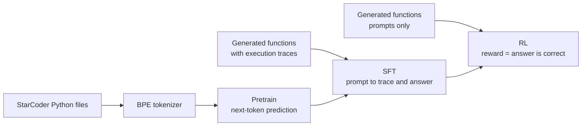

# python-reasoning-lm

> **This project has moved to [mdpead/lab](https://github.com/mdpead/lab/tree/main/projects/python_reasoning)**, under `projects/python_reasoning`, with its full commit history. It now builds on `mlcore`, the shared library in that repo. This repository is no longer updated.

[](https://github.com/mdpead/python-reasoning-lm/actions/workflows/ci.yml)

A language model built from scratch and trained through three stages on a single 16 GB GPU: pretraining on Python source, supervised fine-tuning to trace small programs step by step, and reinforcement learning with rewards checked by actually running the program.

Nothing here wraps a training framework. The attention kernel, the mixture-of-experts layer, the samplers, the generation loop with its KV cache, and the RL loop are all written in this repo, with tests.

> **Status:** the full pipeline has been run end to end at full size, and every stage is tested. Pretraining adds about 3 points of accuracy over training from scratch, provided the fine-tuning learning rate is kept high. RL helped on one of three tasks.

## What it does

The model is asked what a generated Python function returns for given arguments. It writes out the executed lines with the values they produce, then the answer:

```
def f(a, b):
    a *= ((a * -1) * -2)
    b = (-2 * 8)
    a = a
    return a, b

# What does f(9, -3) return?

<|think|>a *= ((a * -1) * -2)  ->  a = 162
b = (-2 * 8)  ->  b = -16
a = a
return a, b<|/think|><|answer|>(162, -16)<|/answer|>
```

The functions are generated, not scraped, so the supply is unlimited and every answer can be verified by executing the code. That makes the task usable for both supervised learning (the trace is the target) and reinforcement learning (the reward is whether the answer is right). Three difficulty tiers go from straight-line arithmetic to nested loops over lists. There is also the reverse task, input prediction: given the function and a result, find arguments that produce it.

## Pipeline



| Stage | Data | Objective | Script |
|---|---|---|---|
| Pretrain | [StarCoder](https://huggingface.co/datasets/bigcode/starcoderdata) Python, split by repository | Next-token prediction | `scripts/pretrain.py` |
| SFT | Generated functions with traces | Cross-entropy on the completion only | `scripts/sft.py` |
| RL | Freshly generated functions, no traces | GRPO: policy gradient on group-relative advantage | `scripts/rl.py` |


Pretraining took about 13.5 hours and SFT about 9 hours on one RTX 5070 Ti; RL took 31 minutes. The RL panel's movement is within the noise of its 375-prompt test set, and the larger evaluation below confirms RL changed nothing.

Each stage starts from a pinned checkpoint of the one before, writes to its own directory, and resumes exactly where it stopped. A stage's directory is cleared automatically if the parts of the config it depends on change.

## Results

Models have 352M parameters (213M active per token). All figures are greedy pass@1 on the easy tier.

### Pretraining

Output prediction, on 3,022 held-out prompts over 780 functions that no stage trained on:

| Starting point for SFT | SFT learning rate | After SFT | After 100 RL steps |
|---|---|---|---|
| Pretrained on 1.3B tokens of Python (`base_lr3`) | 3e-4 | **89.3%** | **89.3%** |
| Random init (`sft_only`) | 3e-4 | 86.3% | 86.1% |
| Pretrained, same weights (`base`) | 1e-4 | 81.3% | 73.6% |

**Pretraining is worth about 3 points:** +2.9, with a 95% interval of +1.7 to +4.2. The first two rows differ only in their starting weights: same tokenizer, architecture, SFT data and schedule, and RL settings. The interval comes from a bootstrap that resamples whole functions, because prompts on the same function tend to succeed or fail together. A smaller 375-prompt test set had put the gap at 5 points; the larger set shows part of that was noise.

**The fine-tuning learning rate matters more than pretraining.** The same pretrained weights fine-tuned at a third of the rate, a common choice for pretrained models, finished 8 points lower and 5 points below the model trained from scratch. Its validation loss barely improved over the last quarter of SFT and ended at 0.0138, while the run at 3e-4 kept improving to 0.0068.


### RL by task

These runs start from the `sft_only` model:

| Task | After SFT | After RL | Prompts with signal per RL step |
|---|---|---|---|
| Output prediction: what does `f(args)` return? | 84.8% | 86.1% (100 steps) | about 1 in 5 |
| Input prediction: what arguments make `f` return this? | 49.3% | 48.0% (100 steps) | about 1 in 3 |
| Search: guess arguments, trace them, try again | 36.4% | 41.2% (300 steps) | about 5 in 6 |

**RL helped only on search.** Output and input prediction moved by about a point, within the noise of their test sets. On the larger test set above, RL left both 3e-4 models unchanged to within a point, and made the 1e-4 model 8 points worse. Search gained about 5 points on 2,024 held-out prompts, where the standard error is about 1 point. The search task's graded reward is the likely reason: it gives RL something to learn from on most prompts.

Full tables, per-step curves and failure analysis are in [docs/results.md](docs/results.md). Model and kernel details are in [docs/model.md](docs/model.md), the RL loop in [docs/rl.md](docs/rl.md), and the problems hit along the way in [docs/lessons.md](docs/lessons.md).

## Running it

Requires Linux, an NVIDIA GPU with CUDA, and Python 3.13. Developed on an RTX 5070 Ti (16 GB) with PyTorch 2.12 and Triton 3.7.

```bash
pip install -r requirements.txt

# Smoke test: a tiny model through every stage
python -m scripts.tokenizer --config test
python -m scripts.pretrain --config test
python -m scripts.sft --config test
python -m scripts.rl --config test

# Full size
python -m scripts.tokenizer --config base
python -m scripts.pretrain --config base
python -m scripts.sft --config base
python -m scripts.rl --config base
```

Everything is driven by the YAML files in `configs/`. Each value there carries a comment explaining why it is what it is. Outputs go to `models/<config name>/<stage>/`: checkpoints, a `results.json` with every training and validation record, a log, and a snapshot of the config.

The tokenizer and pretraining stages download part of StarCoder from Hugging Face, which needs an account that has accepted the dataset's terms.

The tokenizer is its own stage, so a configuration can skip pretraining. `sft_only` has no pretrain stage: run `scripts.tokenizer`, then `scripts.sft`, which trains from random init because the config sets no `train.sft.init_from_step`.

`base` fine-tunes at 1e-4, which underfits. To reproduce the best result, run `base`'s tokenizer and pretrain stages, then `scripts.sft` and `scripts.rl` with `--config base_lr3`, which starts from `base`'s pretrained weights at 3e-4. Its run directory has to be seeded by hand first; the commands are in the comment at the top of `configs/base_lr3.yaml`.

The `input` and `search` configurations start from the `sft_only` model instead of running their own pretraining. Each run directory has to be seeded by hand first; the three commands are in the comment at the top of `configs/input.yaml` and `configs/search.yaml`.

### Evaluation and charts

```bash
# Greedy pass@1 for a checkpoint on ~3,000 prompts no stage trained on
python -m scripts.evaluate --config base_lr3 --stage sft --step 10000

# Gap between two results, with a 95% interval from a bootstrap over functions
python scripts/compare_evals.py models/base_lr3/eval/sft_10000.json models/sft_only/eval/sft_10000.json

# Regenerate the charts in docs/ from the run logs
python scripts/plot_curves.py
```

The evaluation draws its functions from a seed no stage trains on, and keeps only those that fall on the test side of every stage's train/test split. A function the generator happens to produce again elsewhere is therefore never one a model trained on.

### Tests

```bash
pytest                                                      # 241 tests with CUDA, 101 without
pytest tests/test_flash_attention_perf.py --benchmark -s    # kernel timings
ruff check . && ruff format --check .                       # lint and formatting
```

Tests that build a model or call the Triton kernels are marked `cuda` and skipped without a GPU. The rest, covering program generation, data preparation, sampling and reward scoring, run on CPU in a few seconds.

## Layout

```
configs/        YAML configs: test (tiny), base (16 GB card), base_lr3, sft_only, input, search, search_lr3, search_closest
scripts/        One entry point per stage, plus evaluation, comparison and charts
src/
  model.py        Transformer, GQA, RoPE, mixture of experts
  kernels/        Triton kernels, including flash attention forward and backward
  synth.py        Function generator, tracer, and answer checkers
  data.py         Datasets for each stage and their train/test splits
  dataloader.py   Token-budget and prompt-count samplers, collation
  generation.py   Batched sampling with a KV cache
  train.py        Pretrain/SFT loop, checkpoints, resume, schedules
  rl.py           GRPO loop and RL validation
docs/           Results, model and kernel, RL loop, lessons learned
tests/          One file per module
```

## Limitations and next steps

- The pretraining result rests on one training run per arm. Its interval covers test-set noise but not run-to-run variation; a second seed would measure that.
- RL made the 1e-4 model 8 points worse, and its training reward fell over the run too. Why RL hurt this model and left the others alone is not yet understood.
- Pretraining saw 1.3B tokens, about 6 per active parameter, well short of compute-optimal. A longer run may widen the gap.
- RL has shown a clear gain on held-out prompts on one task, search, and none on output or input prediction. The search gain levelled off at about 5 points, and nearly all successes are still first-attempt hits: the model searches longer and without repeating itself, but its later guesses are not yet informed by the misses before them.
- The input-prediction format makes the model commit to its arguments before it has written any working.
- RL is the minimal form of GRPO. There is no clipping, no KL penalty against the SFT model, and one update per batch of rollouts.
- The reward is all-or-nothing on output and input prediction. Search has a graded reward, and it is the only task where RL has helped.
- Only the easy tier has been trained. The generator and checkers already support harder tiers.
- Generation still dominates RL step time. It is bound by per-operation overhead, not compute: the GPU sits at 25 to 45% while decoding. The KV cache is re-concatenated on every pass, and the decode step is not compiled.
- The RL and SFT scripts rely on PyTorch's expandable-segments allocator, which is still marked experimental, to keep varying batch shapes from fragmenting GPU memory.
- The RL hyperparameters in the configs are starting points from short trials, not tuned values.

## License

MIT. See [LICENSE](LICENSE).
